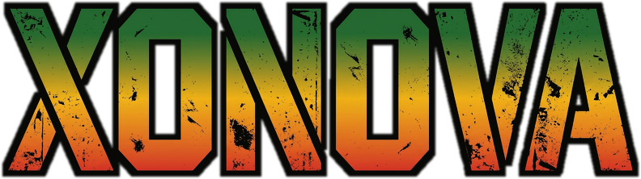

  
  &nbsp;&nbsp;
  

# XONOVA releases

XONOVA is a free polyphonic wavetable synthesizer (VST3, CLAP, LV2 and standalone) by
**Monkey Business Sound System (MBSS)**: three wavetable oscillators with dual warp stages, two
filters, a modulation oscillator, an FX rack, drag-and-drop modulation, and 200 presets made for
jungle, drum & bass, dub and ragga.

This repository holds release notes and version tags only. The plugin checks it to tell
you when a new version is out. It contains no source code.

Download XONOVA from the Monkey Business Soundsystem website. XONOVA is free to use but
not open source.
