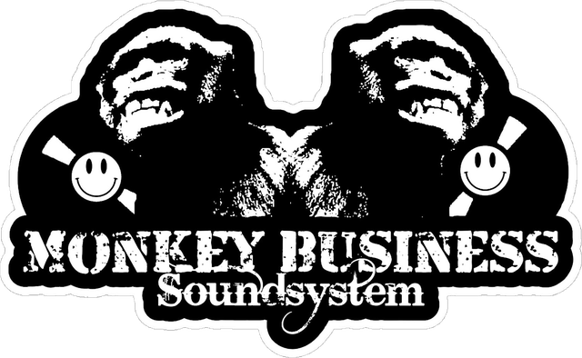
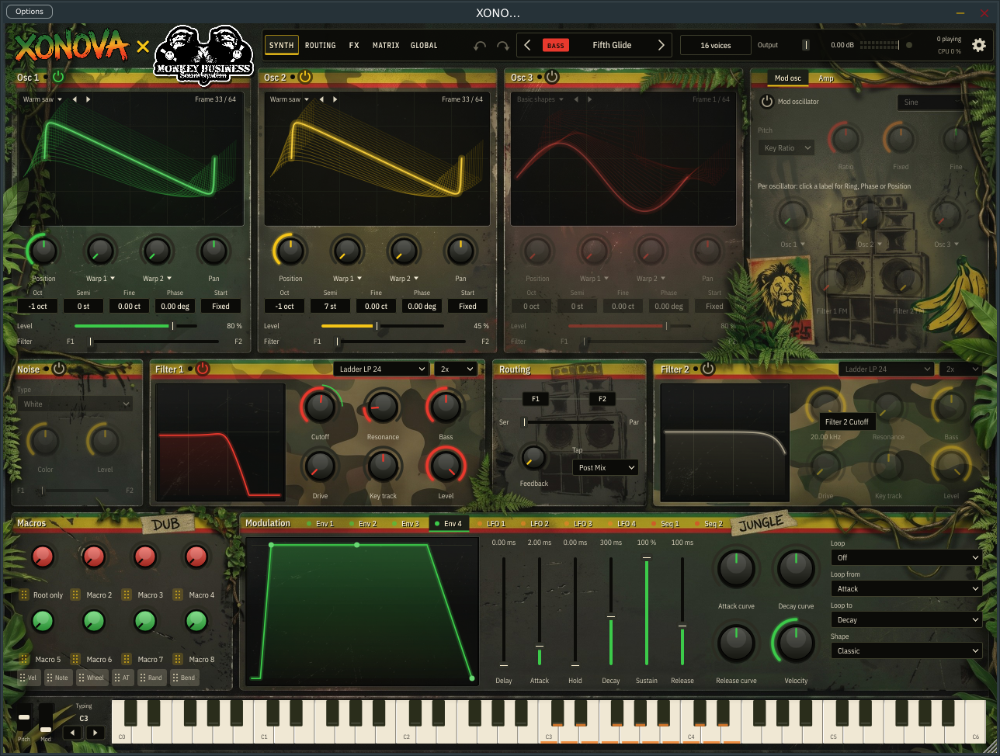

  
  &nbsp;&nbsp;
  

# XONOVA releases

XONOVA is a free polyphonic wavetable synthesizer (VST3, CLAP, LV2 and standalone) by
**Monkey Business Soundsystem**: three wavetable oscillators with dual warp stages, two
filters, a modulation oscillator, an FX rack, drag-and-drop modulation, and 200 presets made for
jungle, drum & bass, dub and ragga.

## Download

Get the latest version from the **[Releases page](https://github.com/Antik79/xonova-releases/releases)**:

| System | File |
|---|---|
| Linux (64-bit) | `XONOVA-<version>-linux-x86_64.tar.gz` |
| Windows (64-bit) | `XONOVA-<version>-windows-x64.zip` |

Installation, the full manual and troubleshooting are in the
**[XONOVA documentation](https://antik79.github.io/xonova-docs/)**.

XONOVA is free to use but not open source. Once installed, it checks this repository once a day
and tells you when a new version is out.

## Support Monkey Business Soundsystem

XONOVA is made with and for **Monkey Business Soundsystem**, the Belgian jungle, drum & bass and
breakbeat crew. Check out their events, music and artists at **[mbss.be](https://www.mbss.be)**.
If XONOVA is useful to you, a donation to support Monkey Business Soundsystem is very welcome.
