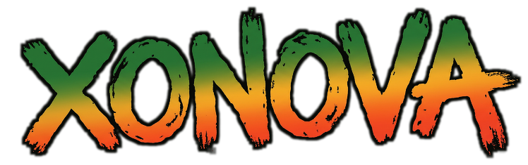

  

# FAQ and troubleshooting

- [General](#general)
- [Installing and loading](#installing-and-loading)
- [Sound and performance](#sound-and-performance)
- [Presets, wavetables and controllers](#presets-wavetables-and-controllers)
- [Reporting a problem](#reporting-a-problem)

## General

**Is XONOVA really free?**
Yes. You can use it on as many computers as you like, for personal and commercial work, and everything you
make with it is yours. It is not open source, and you may not sell or redistribute it. See
[LICENSE.md](../LICENSE.md).

**Where do I download it?**
Only from the [Monkey Business Soundsystem website](https://mbss.be). This repository holds the release
notes and documentation, not the downloads.

**Is there a macOS version?**
Not yet.

**How do I know when there's an update?**
XONOVA checks this repository's [releases](https://github.com/Antik79/xonova-releases/releases) and shows a
badge when a newer version is out. You can also *Watch → Custom → Releases* on this repository to get a
notification from GitHub.

## Installing and loading

**My DAW doesn't show XONOVA.**
- Check the plugin is in the right folder (see [INSTALLING.md](INSTALLING.md)).
- Rescan plugins in your DAW. Some hosts need a full rescan or a restart.
- On Windows, the VST3 must go in `C:\Program Files\Common Files\VST3`. If your DAW only scans custom
  folders, add that one.
- On Linux, the plugins go into your home folder (`~/.vst3`, `~/.clap`, `~/.lv2`). Make sure your DAW scans
  those paths.

**On Linux, XONOVA won't load or the app won't start.**
XONOVA needs glibc 2.35 or newer. Run `ldd --version` to check yours. Older distributions (for example
Ubuntu 20.04) are not supported.

**Windows says "Windows protected your PC" when I start XONOVA.exe.**
That happens with apps Windows doesn't recognise yet. Click **More info**, then **Run anyway**. The plugins
aren't affected.

**Which format should I use?**
Use whatever your DAW supports best. CLAP and VST3 work the same way in XONOVA. LV2 is there for Linux
hosts like Ardour and Carla.

## Sound and performance

**I get crackles or dropouts.**
The CPU figure in the header shows how much of each audio block's time XONOVA needs. Near 100 % you get
dropouts. To bring it down:
- lower the polyphony
- use fewer unison voices (Global page)
- set the filters' oversampling to 1x or 2x
- turn off FX slots you don't use
- raise your audio buffer size

**The output level dot lights up.**
That's the safety limiter catching peaks. Turn down the output level, or the levels and drive inside the
patch.

**The displays are distracting, or the interface feels slow on my machine.**
Turn off **Animated displays** in the gear menu.

**The window is too big or too small.**
Use **Interface size** in the gear menu (60 % to 200 %) or drag the window corner. New instances open at the
size you last chose.

**The typing keyboard doesn't play in my DAW.**
Click the XONOVA window first so it has keyboard focus. Some DAWs keep certain keys for their own shortcuts;
the standalone app gets them all.

## Presets, wavetables and controllers

**Where are my presets?**
In the `Presets` folder under `~/.local/share/MBSS/XONOVA` (Linux) or `%APPDATA%\MBSS\XONOVA` (Windows).
Right-click a preset in the browser and choose to show its file.

**Can I use my own wavetables?**
Yes. Choose **Import WAV file...** in an oscillator's table menu. Imported tables are saved inside the preset
and the session, so projects open anywhere without the original file. See
[WAVETABLES.md](WAVETABLES.md#your-own-wavetables).

**My hardware controller assignments disappeared.**
MIDI learn assignments are saved as your default and come with you into new sessions, but a session saved
with its own assignments uses those instead. Presets never change them. The gear menu's
**MIDI controllers** lists every assignment.

**I can't assign a controller to bank select or sustain.**
That's on purpose: bank select, sustain and channel-mode messages can't be assigned. CC 1 (mod wheel) and
CC 74 (timbre) keep their built-in roles even when you assign them.

## Reporting a problem

1. In XONOVA, open the **Global** page, go to the **About** panel and click **Copy system info**. This copies
   the version, plugin format, host, system and audio settings.
2. Describe what you played, which DAW you used, and what went wrong or felt off.
3. Add screenshots or a short recording if you can, and the preset if it's your own.
4. Send it to MBSS through the [Monkey Business Soundsystem website](https://mbss.be).

---

[← Back to the README](../README.md) · [User guide](USER_GUIDE.md) · [Installing](INSTALLING.md) · [Wavetables](WAVETABLES.md)
