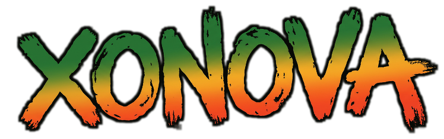

<p align="center">
  
</p>

# Installing XONOVA

Download the archive for your system from the [Monkey Business Soundsystem website](https://mbss.be).

- [Linux](#linux)
- [Windows](#windows)
- [macOS](#macos)
- [Where your files live](#where-your-files-live)
- [Updating](#updating)

## Linux

**Requirements:**
- 64-bit (x86_64) Linux with glibc 2.35 or newer: Ubuntu 22.04+, Debian 12+, Fedora 36+, Linux Mint 21+,
  current Arch / Manjaro / CachyOS
- ALSA or JACK (PipeWire works through either)

**Install (for your user, no root needed):**

```sh
tar xzf XONOVA-<version>-linux-x86_64.tar.gz
cd XONOVA-<version>-linux-x86_64
./install.sh
```

This copies:

| Format | To |
|---|---|
| VST3 | `~/.vst3/XONOVA.vst3` |
| CLAP | `~/.clap/XONOVA.clap` |
| LV2 | `~/.lv2/XONOVA.lv2` |
| Standalone | `~/.local/bin/xonova` |

Then rescan plugins in your DAW. You can also copy the plugins to your plugin folders by hand, and run
`./XONOVA` from the archive for the standalone app.

**Uninstall:** `./install.sh --uninstall` removes the plugins and the app. Your presets and settings are
left alone (see [where your files live](#where-your-files-live)).

## Windows

**Requirements:** 64-bit Windows and a VST3 or CLAP host (FL Studio, Reaper, Bitwig, Ableton Live,
Cubase, Studio One and others).

**Install:**

1. **VST3:** copy the `XONOVA.vst3` folder to `C:\Program Files\Common Files\VST3`.
2. **CLAP:** copy `XONOVA.clap` to `C:\Program Files\Common Files\CLAP`. Create the folder if it doesn't
   exist.
3. Rescan plugins in your DAW.

The standalone app is `XONOVA.exe` and can live anywhere.

The first time you run `XONOVA.exe`, Windows may show **"Windows protected your PC"**. Click **More info**, then **Run anyway**. The plugins load in your DAW without this prompt.

**Uninstall:** delete `XONOVA.vst3`, `XONOVA.clap` and `XONOVA.exe` from where you put them.

## macOS

There is no macOS release yet.

## Where your files live

Your presets, imported wavetables, favourites, settings and MIDI controller assignments are stored here:

| System | Folder |
|---|---|
| Linux | `~/.local/share/MBSS/XONOVA` |
| Windows | `%APPDATA%\MBSS\XONOVA` |

Inside that folder:

- `Presets/`: your own presets
- `Wavetables/`: WAV files listed in the wavetable menu
- `Favourites.txt`
- `Settings.xml`
- `MidiMappings.xml`

The gear menu in XONOVA can open the presets and wavetables folders for you. Back this folder up to keep
your sounds, or copy it to another computer to take them with you.

## Updating

XONOVA tells you when a new version is out: a badge appears in the plugin and links to the
[release notes](https://github.com/Antik79/xonova-releases/releases). Download the new archive from the
[MBSS website](https://mbss.be) and install it over the old one, the same way as above. Your presets and
settings are kept.

---

[← Back to the README](../README.md) · [User guide](USER_GUIDE.md) · [Wavetables](WAVETABLES.md) · [FAQ](FAQ.md)
